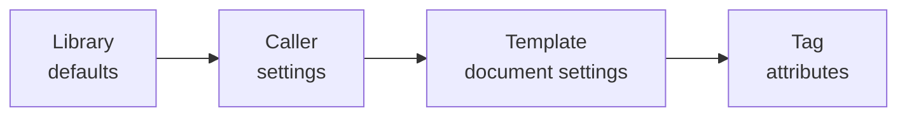

> **Status: Current.** Reference for template authors.

## Attributes

A tag takes attributes after its path, with values quoted by `"` or `'`:

| Tag | Attribute |
|---|---|
| `<$Invoice.Date format="yyyy-MM-dd">` | `format`: a .NET format string, or one of `date`, `time`, `datetime`, `number` to use the document's pattern for that kind. |
| `<$Total culture="en-GB">` | `culture`: the culture this value prints in, whatever its kind: a name like `nl-BE`, or `invariant`. |
| `<$Paid true="yes" false="no">` | `true`, `false`: the words a boolean prints. |
| `<@for line Invoice.Lines sort="Product.Name, Quantity desc">` | `sort`: paths relative to the item, comma separated, each optionally followed by `asc` or `desc`. The sort is stable. |
| `<@for line Invoice.Lines index="n">` | `index`: the name of a counter, read as `<$n>`: 1 for the first item in the loop's order. It prints as a plain integer unless its tag carries a `format`. |
| `<@for tag Product.Tags separator=", ">` | `separator`: the text written between two items of a loop that sits in one paragraph, as typed. A loop whose tags sit in paragraphs or rows of their own writes none, which `Validate` reports. |
| `<$Invoice.Comment blank="none">` | `blank`: the text printed when what the binding would print is empty or white space: a null value, empty or white-space text, an empty collection, a path that breaks. Zero prints as a number. |
| `<$Invoice.IsCreditNote map="Titles">` | `map`: the value prints the text the map of that name gives for it, see Maps. |
| `<$Issuer.Logo empty="keep" fit="contain">` | On a picture tag: `empty` and `fit`, see Pictures. |

An attribute a tag of that kind does not know is a validation error.

## Document settings

A template carries its own defaults as custom document properties (File, Properties, Custom Properties): `culture`, `number-culture`, `date-culture`, `date`, `time`, `datetime`, `number`, `true` and `false`. `RenderSettings` carries the same settings for the caller. Formatting layers from the library's defaults (the invariant culture, no patterns, the words `true` and `false`) up through the caller's settings, the template's properties and the tag's attributes; the last layer wins, so a template whose `number` property says `#,##0.00` prints its numbers that way whatever the caller passed.

A culture is a .NET name such as `nl-BE` or `en-GB`, or `invariant` for the invariant culture, whose month names and separators are the same on every machine. `number-culture` and `date-culture` set one kind apart from `culture`: numbers print in `number-culture`, dates, times and date-times in `date-culture`, and the rest follows `culture`, sorting included; a kind without a culture of its own follows `culture` too. The layers combine the cultures as style sheets do: a layer that sets `culture` resets the cultures per kind of the layers below it, and within one layer a culture per kind wins over `culture`, whatever the order of the properties. So a caller that prints `1.250,50` and `14-Sep-2026` with `Culture = nl-BE` and `DateCulture = invariant` is overridden as a whole by a template whose `culture` says `en-GB`, while a template whose `date-culture` says `nl-BE` changes only the dates. A tag's `culture` prints that one value in that culture whatever its kind, and is the only culture attribute a tag takes.

The layers, lowest first; an arrow points from a layer to the layer that overrides it:

## Values

- Null prints blank; text prints as it is.
- A boolean prints the `true` or `false` word.
- A date prints with the `date` pattern when it has no time of day and with the `datetime` pattern otherwise; on .NET, a `DateOnly` prints with `date` and a `TimeOnly` with `time`.
- A number prints with the `number` pattern; any other formattable value, such as a `TimeSpan` or a `Guid`, prints with the tag's `format`.
- An enum prints its name. A collection bound as a value prints its items one after the other, formatted, with nothing between them; a loop is what separates them.
- Everything else prints through `ToString()`.

Patterns are .NET format strings, applied in the culture of the value's kind: `number-culture` for a number, `date-culture` for a date or a time, and `culture` unless they say otherwise.
