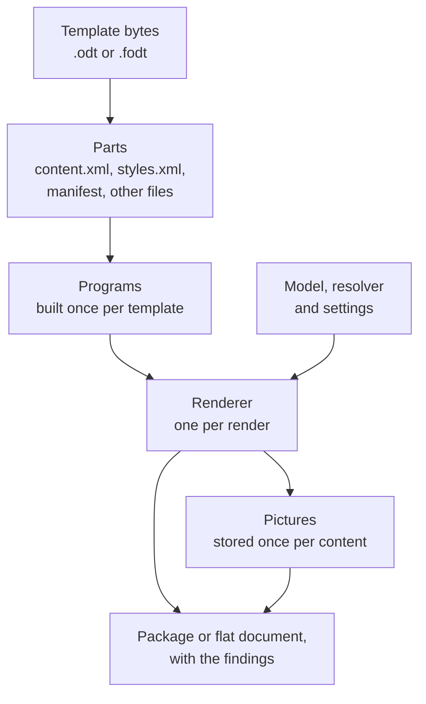

> **Status: Current.** Explanation for maintainers.

This page explains how the core package is put together, so that a change lands in the right
place. The [API](../api.md) page is the contract an application relies on; what this page
describes can change with any version. The core is organized by stage: `Tags` parses the text of
a tag, `OpenDocument` reads and writes the document, `Rendering` prepares a template and renders
it, `Xml` handles blocks and output, `Models` holds the model contracts and the formatting,
`Inspection` lists what a template asks for and `Validation` checks it against a shape. The
folders organize the source; every type of the core sits in the one namespace `Allors.Documents`,
the name of the package, and the public types are those an application needs.

An arrow points from a stage to the stage that consumes its result.

## Reading a template

`Parts.Read` tells a package from a flat document by the first bytes: a zip signature is a
package, anything else is read as XML. A package yields its `content.xml`, its `styles.xml`, its
manifest and every other file by name. `Flat.Read` splits a flat document into the same parts:
the body with the automatic styles it uses becomes `content.xml`, the styles and master pages
with theirs `styles.xml`, the meta data `meta.xml`, and every embedded picture a file under
`Pictures/`, named by a hash of its bytes. From here on the engine does not know which form it
read.

`Program.TryBuild` prepares each rendering part once, for the life of the template. It loads the
part with every white-space character kept, since Writer writes a part without indentation of its
own, and walks it with the inspector's part walker, which collects the tags in placeholder
fields, the frames whose description is a picture tag, the map tables and the problems it cannot
read past. An unbalanced block is a blocking finding here: the template is read, and `Render` throws
`TemplateException` with it. The tags are paired into blocks
with `XmlPair`, and `BlockStructure` decides whether a block's begin, elses and end sit where the
renderer can cut: in paragraphs of one container or in rows of one table. A block that would cut
a table blocks as well. Then the rewrite: every placeholder becomes an instruction element in the
program's own namespace, every block one element around what sat between its tags with a branch
element per else, the paragraphs or rows that held block tags gone; a bound frame stays where it
is and is an instruction itself; a map table leaves the part. A tag that could not be read stays
as the text the author typed and is kept as a finding that every render reports. The template
keeps its files, its manifest, its programs, its maps and the document settings read from
`meta.xml`, and changes none of them afterwards; that is what lets one template render from any
thread.

## Rendering

`Render` builds the formatting for the render, the library's defaults with the caller's settings
and the template's document settings applied as layers, picks the resolver, the settings' or the
template's own, and creates one `Renderer` and one `Pictures` store for the render. The template's
renderers, the built-in text renderers and the settings' by name, were frozen when it was read. The renderer
walks each program's DOM and writes it to an `XmlWriter` through `XmlOutput`, which writes the
declaration as LibreOffice does and leaves the XML otherwise as the template had it. Ordinary
nodes pass through; an instruction element executes:

- A binding resolves its path through the `Scope`, which holds the loop variables and counters in
  scope, innermost first, before the root, and reads members through the resolver's
  `TryGetMember`. The value prints as the resolver formats it under the tag's attributes as the
  last layer, through the text renderer the tag's `format` names when it names one, or as the
  text its map gives for it, and `ValueWriter` writes it as Writer saves
  typed text: tabs, line breaks and runs of spaces as their elements. A path that breaks prints
  nothing; a member the model does not have is reported once per tag.
- A condition writes the first branch whose test holds: the resolver's `IsTrue` for `<@if>`, the
  existence of the member for `<@ifdef>`.
- A loop asks the resolver for its items, sorts them by the keys with the resolver's `Compare`
  when the tag says so, and renders its body once per item with a scope pushed for the variable
  and the counter; the separator is written between the items of a loop that sits in one
  paragraph.
- A bound frame asks the resolver for the picture, or the picture renderer the tag's `format`
  names for one drawn to the frame's size, tells its format from the bytes with
  `PictureFormat`, gives it to the settings' picture processor when there is one, stores it in
  `Pictures` once per distinct content under
  `Pictures/<path>.<ext>`, reads its proportions from the header with `PictureSize`, and lets
  `Fitting` compute the frame's size for the tag's `fit`, in the unit the frame was drawn in,
  through `Length`. Frame names are made unique as they are written.

A finding is recorded once per tag, kind and path. After both parts, `Pictures.Files` drops the
template's pictures that no frame links to any more and adds the stored ones to the manifest,
which passes through byte for byte when nothing changed. `Package.Save` writes the package the
way Writer does, the `mimetype` entry first and stored, pictures that are compressed already
stored and the rest deflated; `Flat.Write` merges the parts back into one document with the
pictures embedded. The result is the document and the findings.

## Inspection and Validate

The constructor builds the `Inspection` from the parts with the same part walker that
`Program.TryBuild` uses, over a DOM of its own, and it holds what the walker collected: the tags
as a tree with their locations, the bound pictures, the maps,
the document settings and the problems. It rewrites nothing and throws for nothing a template
says.

`Validate` checks the inspection against an `IShape`. The problems become
findings. The validator visits the tags with scopes of its own: a loop variable carries the shape
of the collection's items, and each branch of a condition is checked in the scope its test opens,
narrowed through `NarrowedShape` to the variants of an abstract shape that have the guarded
member. Block placement is replayed with `XmlPair` and `BlockStructure`, so that the validator
reports what `Render` would throw, together with the text that the paragraph or row of a
block tag would lose. Attributes are checked against the lists in `TagSyntax`, cultures through
`Formatting`, patterns by the grammar in `Patterns` and against the `ValueKind` of the shape at
the tag's path, as are loops, sort keys and picture frames, maps for their use and
their default row, and the document settings for their names, cultures and patterns. The findings come sorted: `content.xml`, then
`styles.xml`, then the settings.

## Where a rule lives

| Rule | Types | Tests |
| --- | --- | --- |
| The tag grammar, keywords and attribute names | `TagSyntax`, `Tag`, `SortKey` | `TagSyntaxTests` |
| Where a block may begin, branch and end | `BlockStructure`, `XmlPair` | `BlockTests`, `ElseTests`, `XmlPairTests` |
| Iteration, truthiness, formatting, ordering and pictures of values | `Resolver` | `ResolverContractTests`, `ValueTests`, `FormattingTests` |
| The formatting layers and the cultures per kind | `Formatting` | `FormattingTests` |
| How a value is written into XML | `ValueWriter` | `EscapingTests`, `WhitespaceTests` |
| Pictures: formats, sizes, storage and fit | `PictureFormat`, `PictureSize`, `Pictures`, `Fitting`, `Length` | `PictureTests`, `PictureSizeTests`, `FitTests` |
| The program and the render of each tag | `Program`, `Renderer`, `Scope` | `ProgramTests`, `RenderingTests`, `MapTests`, `SeparatorTests`, `BlankTests` |
| The output as Writer saves it, packages and flat documents | `XmlOutput`, `Package`, `Flat`, `Manifest` | `OutputTests`, `PackageTests`, `FlatTests` |
| What a template asks of its model | `Inspector` | `InspectionTests` |
| Validation against a shape, including narrowing | `Validator`, `NarrowedShape` | `ValidationTests`, `IfDefTests` |
| Dictionary and reflection models | `DictionaryShape`, `DictionaryResolver`, `ReflectionShape`, `ReflectionResolver` | `DictionaryShapeTests`, `ReflectionShapeTests`, `ReflectionResolverTests` |

The tests build their templates in code with the `Odt` and `Fodt` helpers; the few real files
under `Resources` are fixtures for what needs one.

## Invariants

- A template does not change after it is read, and a render owns everything it changes: the
  renderer, the scopes and the picture store. One template serves any number of concurrent
  renders.
- The core has no third-party dependencies and uses no reflection; `DictionaryResolver` is its
  only resolver. Reflection lives in `Allors.Documents.Reflection`.
- The output reads as the template did: the declaration, the comments and processing
  instructions, a full end tag on every element and the author's white space kept, and a manifest
  nothing changed passes through unchanged.
- What a template says never throws when it is read; the structural errors throw at `Render`,
  with findings, and `Validate` reports them.
- A finding names the tag as typed, the path, the part and the paragraph, in the author's terms.
